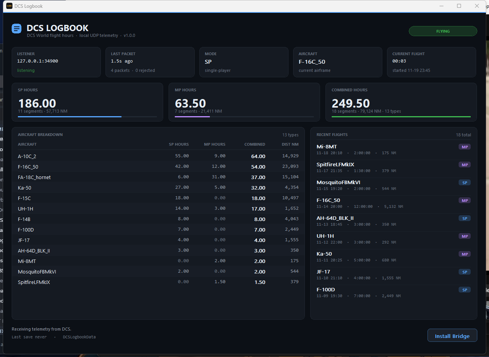

# DCS Logbook


A native Windows companion for **DCS World** that keeps a local flight log:
Single-Player and Multiplayer hours, per-aircraft totals, and **flight distance
in nautical miles** — counted only while you are actually flying.



*Screenshot shows representative demo data.*

- Pure **Odin + Win32** application: no runtime, no framework, no third-party
  packages, a single `.exe`.
- Receives live telemetry from DCS over **loopback UDP** (`127.0.0.1:34900`).
- Saves data next to the executable; no account, no cloud, no network egress.
- Installs/updates the required DCS Lua bridge itself on first launch.

---

## Features

- **Automatic logging** — start DCS, fly, and the logbook fills itself. No
  start/stop buttons.
- **Airborne-only time** — cold starts, hot starts, taxi and parked time are not
  counted. Takeoff starts a flight; landing ends it. A touch-and-go closes the
  old segment and starts a new one.
- **SP, MP and combined hours**, plus per-aircraft breakdown and segment counts.
- **Real 3D flight distance** in NM, integrated from ownship position every
  second. Loops, turns and climbs count; teleports/loads are rejected.
- **Crash-safe history** — append-only `flights.jsonl`, atomic `flights.json`
  snapshots, and `active.json` recovery if the app is killed mid-flight.
- **Autosave every 10 s** while flying, with a green check flashed in the
  footer. Close the app whenever you like; closed flights are already on disk.
- **Portable** — the logbook lives in `DCSLogbookData\` next to the `.exe`.
  Copy the folder to another machine and your logbook comes with it.
- **Multiplayer aware** — SP/MP detected automatically; servers that block
  ownship export are shown as blocked instead of inventing data.
- **Click-only UI** — no keyboard shortcuts.
- **Auto-installing bridge** — no file copying, no config editing. The app
  writes the Lua bridge into DCS's Saved Games folder and keeps it up to date.

---

## Requirements

- Windows 10 or 11, 64-bit.
- DCS World installed and run at least once (so its Saved Games folder exists).
- No administrator rights required.

---

## Install

1. Download `DCSLogbook.exe` from the GitHub **Releases** page.
2. Put it in a **writable folder**, for example:
   - `C:\Users\<you>\Documents\DCSLogbook\`
   - `C:\Users\<you>\Desktop\`
   - `D:\Games\DCSLogbook\`

   Do **not** put it in `Program Files` — the app always keeps its data next to
   the executable and refuses to start if that folder is not writable.
3. Double-click `DCSLogbook.exe`.
   - Windows SmartScreen may warn about an unsigned executable: choose
     **More info → Run anyway**.
4. If DCS is installed, the app installs the Lua bridge automatically on first
   launch and the footer confirms it. If it says **Lua bridge outdated – click
   Install Bridge**, click the button once.
5. **Fully restart DCS** (quit to the desktop and start it again). The export
   Lua state persists across mission reloads, so a mission restart is not
   enough after the bridge is installed or updated.
6. Fly. When you land or leave the aircraft, the flight is saved and the totals
   update.

DCS and the logbook app can be started in any order; they are independent.

### Where is my data?

```
<folder containing DCSLogbook.exe>\
  DCSLogbook.exe
  DCSLogbookData\
    flights.jsonl     append-only history (authoritative)
    flights.json      snapshot + derived totals
    active.json       the currently open flight (removed on clean exit)
    app.log           diagnostics
```

Back up the logbook by copying `DCSLogbookData\`. To move to another PC, copy
the whole `DCSLogbook` folder.

---

## Using the app

- **Status pill** — `WAITING FOR DCS`, `FLYING`, `IDLE` (connected, no flight)
  or `STALE` (telemetry stopped).
- **Info strip** — listener address, last packet age, packet/reject counts,
  current mode, aircraft and current-flight clock.
- **Hours cards** — SP, MP and combined hours, with segment count and distance
  in NM for each.
- **Aircraft breakdown** — per-aircraft SP/MP/combined hours and `DIST NM`.
  Mouse-wheel or drag the scrollbar when the list is long.
- **Recent flights** — newest first, with date, duration and distance.
- **Install Bridge** — manual retry; normally the bridge installs itself.
- The footer shows the last save time and the active data folder. A green check
  flashes for a moment after each autosave.

There are no keyboard shortcuts; every action is a click.

---

## What counts as flight time and distance

| Event | Behaviour |
|---|---|
| Cold/hot start, taxi, parked | Not counted |
| Airborne (wheels off, or hovering) | Time and distance start |
| Landing | Flight ends at touchdown |
| Touch-and-go | Flight ends, a new one starts on the next takeoff |
| Leaving the aircraft / spectator | Flight ends |
| No telemetry for 20 s | Flight ends at the last packet |
| Paused sim | Nothing accrues |

- **Distance** is the 3D path length (`√(dx²+dy²+dz²)`) from DCS's ownship
  `Position`, sampled every second. It measures the path actually flown, so
  loops and turns add miles; base-to-base distance does not matter. Position
  deltas implying more than 1200 m/s (loads, teleports) are rejected. On a build
  without `Position`, true airspeed × time is used instead (≈90–95 % accurate;
  position-based is ≈99 %).
- **Time acceleration** runs on DCS model time, so accelerated flight accrues
  accelerated hours and the same geometric distance. At 8×, one wall minute
  logs about eight flight minutes.
- **Ejection** is a known limitation in DCS 2.9 single-player: the sim keeps
  reporting the pilotless aircraft, and no player event is exposed, so a flight
  ends when that aircraft crashes. Time and distance for those seconds are
  included. This is tracked for a future release.
- **Multiplayer** works the same way. If a server blocks ownship export, the app
  shows `blocked` and records nothing for that flight. Distance uses
  `LoGetSelfData`, which is not affected by the object-export setting, so it
  normally keeps working even on servers that block object export.

---

## Troubleshooting

- **“Lua bridge outdated” / “Lua bridge not installed”** — click **Install
  Bridge**, then fully restart DCS. The app compares the installed bridge with
  the copy embedded in the `.exe` on every start.
- **No hours appear** — check `Saved Games\DCS\Logs\dcs.log` for `DCSLogbook:`
  lines. They report missing files, a missing `Export.lua` loader, LuaSocket
  problems and every active/inactive transition. Also make sure the app is
  running and the footer shows `listening`.
- **“Permission_Denied” for the data folder** — run the `.exe` from a writable
  folder (Documents/Desktop, not `Program Files` or a read-only share).
- **Nothing happens when DCS starts** — the bridge is installed per Windows
  user in `Saved Games\DCS\Scripts`; if DCS runs as a different user, install
  the bridge for that user (see *Manual bridge install* below).
- **Port already in use** — something else is bound to UDP 34900. Close it, or
  use a different port with `--port=<n>` and change `PORT` in
  `Scripts\DCSLogbook\DCSLogbookExport.lua` to match.
- **Two instances** — only one instance per data folder is allowed; a second
  process shows a notice. Running from different folders with different
  `--data-dir` values works.
- **SmartScreen / antivirus** — the executable is not code-signed. If your
  security software quarantines it, allow it explicitly; the app only binds
  loopback UDP and writes inside its own folder plus the DCS Saved Games
  `Scripts` folder.

### Manual bridge install (optional)

The in-app installer is the recommended path. The repository also contains the
Lua sources for manual or scripted installation:

```powershell
.\install.ps1
.\install.ps1 -DcsDir "C:\Users\you\Saved Games\DCS.openbeta"
```

It writes `Scripts\DCSLogbook\DCSLogbookExport.lua`,
`Scripts\Hooks\DCSLogbookHook.lua`, and creates `Scripts\Export.lua` or appends
the loader line to an existing one after making a backup.

Bridge files:

- `lua\DCSLogbook\DCSLogbookExport.lua` — telemetry bridge (1 s timer)
- `lua\Hooks\DCSLogbookHook.lua` — install diagnostics + event forwarder
- `lua\Export.lua` — loader for a fresh install

---

## Build from source

Requirements: [Odin](https://odin-lang.org/) (developed against
`dev-2026-11-nightly`), Windows 10/11 x64. No third-party Odin packages.

```powershell
# Release GUI -> dist\DCSLogbook.exe
.\build.ps1

# Debug console build -> build\dbg.exe
.\build.ps1 -Debug

# Dev tools (simulator, screenshot, click, Lua test harness) -> build\
.\build.ps1 -Tools
```

Or directly:

```powershell
odin build src -out:dist\DCSLogbook.exe -target:windows_amd64 -subsystem:windows -o:speed
odin check src -target:windows_amd64
```

Lua checks (bundled Lua 5.1 dev tools):

```powershell
.\build\luacheck.exe lua\DCSLogbook\DCSLogbookExport.lua lua\Hooks\DCSLogbookHook.lua lua\Export.lua
.\build\luarun.exe tools\luatest\luatest.lua
.\build\luarun.exe tools\luatest\hooktest.lua
```

If PowerShell blocks the scripts, use a per-process policy (no elevation):

```powershell
powershell -NoProfile -ExecutionPolicy Bypass -File .\build.ps1
```

### Project layout

```
DCSLogbook/
  build.ps1                     Build helper (release -> dist\, tools -> build\)
  install.ps1                   Optional script installer for the Lua bridge
  assets/                       Application icon (.ico) + Windows resource (.rc)
  docs/screenshot.png           README screenshot
  src/                          Odin application (package dcslogbook)
    main.odin                   Entry point, CLI, single-instance
    data_dir.odin               Writable exe-relative data folder
    install_bridge.odin         Embedded bridge + startup auto-install
    types.odin                  Types, protocol constants, thresholds
    app.odin                    Threads, packet path, autosave, view snapshot
    tracker.odin                Flight-time/distance state machine
    store.odin                  JSONL history, atomic snapshots, totals
    gui.odin                    Win32 window, layout, painting, input
    draw.odin                   GDI helpers and double buffer
    format.odin                 Hours/clock/date/NM formatting
    timeutil.odin               Local RFC3339 with DST offset
    log.odin                    app.log writer
    instance.odin               Named-mutex single-instance guard
  lua/
    Export.lua                  Loader for a fresh install
    DCSLogbook/DCSLogbookExport.lua   Telemetry bridge
    Hooks/DCSLogbookHook.lua          Diagnostics + event forwarder
  tools/                        Dev-only helpers (not shipped)
  dist/                         Release output (gitignored)
  build/                        Debug binary + dev tools (gitignored)
```

### How it works

```
DCS (Lua) --UDP 127.0.0.1:34900--> DCSLogbook.exe
                                   | JSON decode
                                   | tracker: dt rules, airborne gate, distance
                                   | flights.jsonl append + atomic snapshot
                                   +--> repaint (WM_APP)
```

The Lua side runs on a 1 s model-time timer and does no per-frame work. The Odin
side uses one UDP thread and a standard blocking Win32 message loop; the only
polling is the 500 ms socket timeout so shutdown stays prompt.

---

## Versioning

The app and the embedded Lua bridge are versioned together. On every startup the
app checks the installed bridge and **automatically updates it** when the two
copies differ, so a new release never drifts from its telemetry code.

Current release: **v1.0.0** (app and bridge).

---

## Roadmap

- **Client/server sync** — move flight data to a server so the logbook is
  persistent across reinstallations and available from multiple computers
  (planned direction; the local format already carries a per-segment `id` and a
  `synced` flag for this).
- **Ejection detection** — end the flight at the ejection rather than at the
  aircraft crash.
- **Optional airborne rule** — AGL-threshold variant for modules where
  `LoGetInAir()` is unreliable.
- **JSON export** — return the shareable export to the UI (backend is retained).

---

## Credits & disclaimer

DCS World is a trademark of Eagle Dynamics. This is an unofficial companion
application, not affiliated with or endorsed by Eagle Dynamics.

Third-party libraries: none. Win32 bindings come from Odin's `core:sys/windows`.
